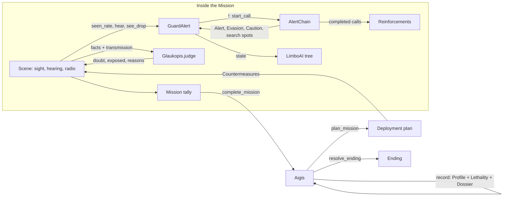
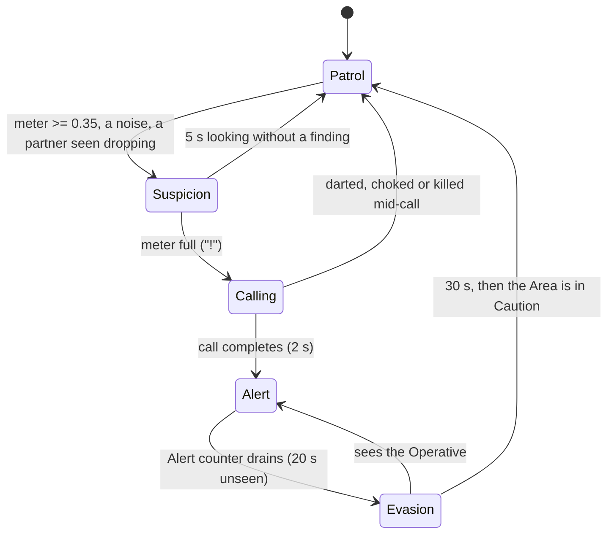
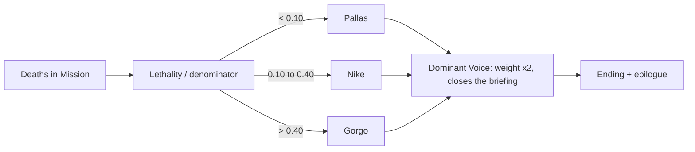

# Ghost Layer: Game AI for an Enemy That Learns

Written for the game AI evaluation. The code identifier appears in parentheses the first time. Target length: 4 to 6 pages plus the appendix. Export to PDF from this file (see "Export" at the end).

> **Pending a person (not invented here):** everything marked `TODO(human)` needs a real play session, screenshots or measurements. The deployment tables and cited rules come from the code and from `docs/deployment-tables.md`, not from playthroughs.

## 1. The Game on One Page

Ghost Layer is a short stealth game. The player is the Operative (Operative), a member of Metis who infiltrates the Palladion facilities. The antagonist is Aigis, a tactical intelligence that **profiles** the Operative and adapts its forces **between missions**. The campaign has three Missions (Harbour, Relay Station, Research Annex) and the Core (Core), the room beneath the Harbour where Aigis lives.

Each Mission can be resolved in three ways (Approach): stealth, deception with spoofed transmissions (Spoofing), or noise. What the player repeats becomes their Profile (Profile) of six Habits (Habits), and Aigis responds with Countermeasures (Countermeasures). Design pillar: **adaptation must be seen and heard**; a countermeasure the player doesn't perceive gets cut.

Inside a Mission the loop follows Peace Walker: short Missions of about three Encounters (Encounter) each, a spotting guard who must radio in before the Area goes to Alert, a Rank (Rank) on the post-Mission screen that the player replays for, and verbs that let the player use a guard rather than only remove him: Hold-up (Hold-up) for one answer, and the Fulton (Fulton) balloon, which lifts a Neutralized guard away and turns him into a Recruit (Recruit) who pays for gear at Requisition (Requisition). Every one of these verbs also feeds the Profile, so Aigis answers them too.

## 2. AI Architecture (Central Section)

Four layers. Each pure module uses no nodes and is deterministic; the scenes gather facts, call the module, and only read its results (ADR-0001, `docs/adr/0001-aigis-plans-only-between-missions.md`).

| Layer | Module | When it acts |
|---|---|---|
| Guards | LimboAI behaviour tree (`actors/guard/guard_tree.tres`) over the pure alert state machine (`actors/guard/guard_alert.gd`) | inside the Mission, every frame, per guard |
| Alert chain | the Area's shared phase, Radio calls and search spots (`ai/alert_chain.gd`), with `ai/reinforcements.gd` and `ai/hq_poll.gd` | inside the Mission, every frame, once per Area |
| Glaukopis | spoofing judge (`ai/glaukopis.gd`) | inside the Mission, per transmission |
| Aigis | campaign module (`ai/aigis.gd`), with its file on the player (`ai/dossier.gd`) | only between Missions |

Key decision: Aigis **does not** plan during the Mission (ADR-0001). Adding Voice behaviour inside the Mission would be a new seam (passing weights into the tree), not a tweak. This means the same Preset always yields the same deployment, which lets us generate the tables in section 8 through tests. The Alert chain is the opposite case: it is pure rules shared by every guard in an Area, with no memory of the campaign.

## 3. Guards

### 3.1 One Guard: Tree and State Machine

Each guard runs a LimboAI tree whose root selector (`Guard`) tries, in order: Alert, Evasion, Suspicion, Radio order and Patrol. Each branch is a sequence "state condition + action" (`bt_in_state.gd` plus `bt_chase.gd`, `bt_search_spot.gd`, `bt_turn_to_spot.gd`, `bt_follow_order.gd`, `bt_patrol.gd`). The Alert branch is itself a selector (`Engage`): a guard who sees the Operative inside 6 m backs off to 9 m (`bt_too_close.gd`, `bt_retreat.gd`) and otherwise chases and shoots from range (`ai/engage.gd`). Patrol may stop to look around at a route stop (`bt_fidget.gd`, a probability plus a cooldown). The tree restarts when the state changes.

`TODO(human)`: screenshot of the `guard_tree.tres` tree open in the LimboAI editor (`docs/img/guard-tree.png`).

The alert machine (`GuardAlert`) takes what the guard sensed: `tick(delta, seen_rate, seen_pos, why, at_target)`, `hear(...)`, `see_drop(...)`, `see_down(...)`, `shot(...)`, `respond(...)`. Each call returns a reason string that the F3 overlay displays. **A full meter no longer alerts by itself:** the guard shows "!", stands still and starts a Radio call; only the Area's Alert chain (3.2) moves guards into Alert.

Values from the code: suspicion at 0.35 ("?"), drain 0.25/s, `LOOK_TIME` 5 s. Vision fills the meter at 1.2/s in a front cone of 30° and 16 m and at half rate in a peripheral cone of 60° and 6 m; crouched x0.5, still x0.6, running x1.5, within 3 m x4. Hearing goes through walls: running footsteps 6 m (x1.3 on metal floors), a knock or thrown magazine 10 m, a choke 6 m only under the Takedowns L3 Countermeasure ("slow, noisy choke"), a loud rifle shot 25 m. Noise only raises suspicion, but a noise more than 1 s into Suspicion adds 0.35 to the meter, so repeated noise escalates; a loud shot starts a Radio call at once. A guard who sees a Down guard fills the same meter up to suspicion and walks over to check: a dead body starts a call, a Neutralized one gets woken.

**Partner reaction.** A guard who sees a partner drop (darted, choked, shot) or kneel at gunpoint within 15 m in his front cone calls the partner's name, goes "?" at that spot and "!" 3 s later (`PARTNER_DELAY`). Shooting is therefore never free when two guards can see each other.

### 3.2 The Area: Alert Chain and Caution

`AlertChain` holds the Area's phase: Normal, Alert, Evasion, Caution.

- **Radio call.** The spotter radios for 2 s (a camera 1.5 s). Downing him in that window stops the call and the Alert never happens. His shout reaches guards within 15 m through walls; they go "!" and converge but never start a second call while his runs. **Only a completed call is an Alert**: it counts for the Rank and sends one Reinforcement squad (`Reinforcements`: 3 guards, 5 at Combat L3, at most 6 alive, gone once the Area is Normal again).
- **Alert.** A 20 s counter, full while any guard sees the Operative, draining while unseen. Chasers run at 5.0 m/s; the Operative runs at 4.4 m/s, so outrunning a chase is never the answer.
- **Evasion (30 s).** The searchers share the search spots: Crawlspace mouths and Ladder feet within 10 m of the last known point, plus a ring of eight directions at 6 m and 11 m snapped to the navmesh. Each searcher reserves its own spot (its walk to the spot plus 1.2 times the spot's distance from the point, lowest wins), and a searched spot isn't sent to again until the next sighting.
- **Caution (60 s, refreshed by new evidence).** Not an Alert and free for the Rank. Guards walk faster (2.2 m/s against 1.8), see 1.25x farther, fill the meter 1.3x faster, and wear an amber vest light so the phase reads without the HUD. Caution starts after Evasion, after a stopped call's local search, when a Neutralized partner is found and when a guard wakes.

**HQ poll** (Downs L1 and L3, `HqPoll`): every 45 s HQ calls one guard by radio; a Down guard is three times likelier to be picked, and the player has 10 s to answer for him (Report in) before the silence sends guards to look.

### 3.3 Verbs the AI Reads

- **Hold-up** (`actors/operative/holdup.gd`): aim at an unaware guard within 6 m. He is freed by an Alert, by distance, by 4 s off aim, or by a partner who sees him; once free he grabs his gun and starts a stoppable Radio call on where the Operative stood. Holding E for 2 s gets one answer, the first that applies: a scripted one, his Voiceprint, the objective's location, or a free Scanner reveal.
- **Fulton**: 3 s held beside a Neutralized or held-up guard, outdoors, 3 balloons per Mission. A balloon seen within 20 m makes guards investigate. The guard is gone, which removes the body, but HQ can still poll him.
- **Rank** (`ai/rank.gd`), node-free and never rolled back by a Checkpoint: S is 0 kills and 0 Alerts, A at most one Alert, B any non-lethal clear, C a kill. Two or more found bodies, going over par (2 min per Encounter) and each Continue drop a letter, never below B. The Rank never reads or writes the Profile: it is a score for replays, not something Aigis learns from.

## 4. Operative Profile

Six Habits (`HABITS`): stealth (stealth), combat (combat), headshots (headshots), takedowns (takedowns), downs (downs) and spoofing (spoofing). Each action adds points (`TRIGGERS`): a quiet down +15 Stealth, a completed Alert +30 Combat, a headshot +20, a takedown +20, a found Down guard +25 Downs, a woken guard +15 Downs, a Fulton +15 Downs (a guard gone missing is still a guard Down), a Spoofed transmission +20 (+20 more if exposed), a Voiceprint given up in a Hold-up +10 Spoofing. Level = points / 100, capped per Mission at 0 / 1 / 2 / 3 (`CAPS`). Stealth and Combat are a tug of war: the Mission sets a tendency, adding to one side and subtracting from the other; a Mission with no alert counts as stealth (+50). The other four Habits decay by half a level per Mission if unused. An aborted Mission is never recorded (`complete_mission`).

Only a **completed** Radio call counts as an Alert for the Profile, so a player who darts every spotter mid-call stays a Stealth player.

## 5. Aigis: Utility-Based Planning (Central Section)

`plan_mission(profile, lethality, mission_index)` returns weights, dominant Voice, budget, pinned Habit, choices with candidates, the dissent, and briefing keys.

1. **Weights:** the dominant Voice weighs 2.0 and the other four 1.0 (`DOMINANT_WEIGHT`, `OTHER_WEIGHT`).
2. **Budget** of response levels per Mission: 0 / 2 / 4 / 6 (`BUDGETS`).
3. **Pinned:** the strongest Habit (highest level; ties broken by points) gets its entire response unlocked first.
4. **Greedy fill:** candidates are the next unlocked rung of each Habit; score = sponsoring Voice's weight x Habit points; the highest is taken, and ties follow the order of the Habits table.
5. **Dissent:** if a step the budget passed over scored at least 75 % of the step that beat it (`DISSENT_FROM`) and belongs to another Voice, that Voice objects in the Briefing before the close. The player hears the close call that the plan made.

It is deterministic: same inputs, same plan. Lethality leaks in openly through the deployment (a lethal campaign receives more Gorgo equipment) while the number itself stays silent and separate from the Profile.

**Dossier** (`ai/dossier.gd`): beside the Profile, the record keeps what Aigis can cite back: event counts over the campaign and, for the last Mission, its tally, the Habit the player dropped, a coarse path and marks. The Briefing uses it to justify a Countermeasure with a number (how many guards were found Down, how many transmissions were sent), from the last Mission when it says enough, otherwise from the campaign. It changes what Aigis says, never what it deploys.

Example (section 8.2): under the Butcher Preset in the Core, the pinned Habit is Combat, the budget is 6, and the plan is vests, +2 guards, squads of 5 reinforcements, and helmets at 33 %, 66 % and 100 %.

## 6. Glaukopis: The Spoofing Judge

Glaukopis (`Glaukopis.judge(facts, commit)`) is the only Aigis logic active inside the Mission, and it does not depend on the Voice weights. It sums deterministic doubt points and exposes the transmission at 40 or more (25 or more with Spoofing level 1). Main facts: voiceprint already flagged +100; the speaker is the recipient +100; a recipient sees the speaker +60; some guard knows the speaker is down +60; "all clear" while a recipient sees the Operative +100; contradicts an order issued less than 30 s ago +30; each transmission in the last 60 s +15.

If exposed, the voiceprint is flagged permanently and recipients search within 5 m of the transmission's origin. The player only hears the guard's line ("you don't sound right"); the doubt and reasons go only to the F3 overlay. Spoofing level 2 adds a verification call to the speaker; level 3 makes voiceprints single-use.

## 7. Lethality, Dominant Voice and Ending

Each death silently adds to Lethality (guard 1, Target 3). The Lethality ratio is Lethality / denominator (guards actually generated + 3 per Target) and picks a band with `resolve_ending`: below 0.10 Pallas, 0.10 to 0.40 Nike, above 0.40 Gorgo (a value exactly on the threshold goes to the higher band; undefined before Mission 1, Pallas band). The band sets the dominant Voice, which closes every briefing, weighs double in the plan, and decides which of three endings plays after the final transmission in the Core and the final debate. The Glaukopis lines in the debate reflect the Spoofing level. A Fultoned guard is not a death: the Fulton is the non-lethal way to clear a body.

## 8. Evidence (Central Section)

### 8.1 How It Is Generated

`tests/test_aigis.gd` runs `plan_mission` for each Preset in each Mission and writes `docs/deployment-tables.md`. What is cited below is a copy of that output; if the balance is tuned again, it must be regenerated and re-cited. The Alert chain, Rank, Reinforcements, HQ poll and Hold-up rules are node-free too and have their own suites (`test_alert_chain.gd`, `test_rank.gd`, `test_reinforcements.gd`, `test_hq_poll.gd`, `test_holdup.gd`). Headless playthroughs (`tools/play_harbour.tscn` and one per Area) walk each Mission end to end, including the Alert chain, a Game Over and Continue, Extraction and Rank.

### 8.2 Deployment Tables (Preset x Mission)

Each step is read as `what [sponsoring Voice, score]` in deployment order; pinned-Habit steps come first. Mission 1 never deploys anything (budget 0).

**Clean slate** (all Habits at 0, ratio undefined; dominant Voice Pallas)

| Mission | Budget | Pinned | Deployed |
|---|---|---|---|
| 1 (Harbour) | 0 | none | none |
| 2 (Relay Station) | 2 | none | none |
| 3 (Research Annex) | 4 | none | none |
| Core | 6 | none | none |

**Butcher** (Combat 3, Headshots 3, Takedowns 1; ratio 0.60; dominant Voice Gorgo)

| Mission | Budget | Pinned | Deployed |
|---|---|---|---|
| 1 (Harbour) | 0 | none | none |
| 2 (Relay Station) | 2 | Combat | vests [Gorgo, pinned]; helmets on 33% [Gorgo, 600] |
| 3 (Research Annex) | 4 | Combat | vests [Gorgo, pinned]; +2 guards [Promachos, pinned]; helmets on 33% [Gorgo, 600]; helmets on 66% [Gorgo, 600] |
| Core | 6 | Combat | vests [Gorgo, pinned]; +2 guards [Promachos, pinned]; squads of 5 reinforcements [Promachos, pinned]; helmets on 33% [Gorgo, 600]; helmets on 66% [Gorgo, 600]; helmets on 100% [Gorgo, 600] |

**Ghost** and **Trickster**, Core only (full tables in `docs/deployment-tables.md`):

| Preset | Habits / ratio | Pinned | Deployed in the Core |
|---|---|---|---|
| Ghost | Stealth 3, Takedowns 2, Downs 2; 0.00 (Pallas) | Stealth | security cameras [Glaukopis, pinned]; one extra patrol [Promachos, pinned]; overwatch sentries [Gorgo, pinned]; guards turn around more often [Pallas, 400]; random HQ poll [Pallas, 400]; patrols in pairs [Gorgo, 200] |
| Trickster | Spoofing 3, Stealth 1, Headshots 2; 0.25 (Nike) | Spoofing | Glaukopis threshold 40 -> 25 [Glaukopis, pinned]; radio callback [Glaukopis, pinned]; single-use Voiceprints [Glaukopis, pinned]; helmets on 33% [Gorgo, 200]; helmets on 66% [Gorgo, 200]; security cameras [Glaukopis, 100] |

Reading: the same four Habits produce different responses depending on the dominant Voice, and the pinned Habit always deploys first. `TODO(human)`: check that the cited rows still match `docs/deployment-tables.md` after the final balance pass.

### 8.3 Before and After

`TODO(human)`: screenshots of the Harbour (Mission 1) under Clean slate and of the Core under Butcher, same camera. Insert `docs/img/before-clean-slate.png` and `docs/img/after-butcher-core.png`. Note: the Harbour itself does not change between Presets (budget 0), so the honest comparison is Harbour under Clean slate versus the Core (which sits below the Harbour) under Butcher.

### 8.4 Debug Overlay (F3) Screenshots

`TODO(human)`: four overlay screenshots: (a) Profile, weights and plan with the candidate scores in the briefing; (b) Glaukopis doubt and reasons after an exposed transmission; (c) the reason a guard detected the Operative; (d) a guard mid Radio call with the Area phase. Planned files in `docs/img/`.

### 8.5 Play Measurements

The session logger (`ai/session_log.gd`) writes one log per run: time per Mission, Alerts per Encounter, who spotted the Operative first and when, darts, rifle shots, Spoofed transmissions, takedowns, Fultons and Hold-ups. The Harbour's onboarding was retuned from these logs (for example: five of six deck runs were first spotted by the same guard within 8 s, so his patrol was moved).

`TODO(human)`: this document contains no measurements from real play. If we want to cite them (time per Mission, Alerts per Mission, calls stopped against calls completed, Glaukopis exposure rate), take them from the session logs of real runs; they are not estimated here.

## 9. Limits and Future Work

- Aigis only plans between Missions; there is no adaptation within a Mission (ADR-0001 decision; a new seam would be needed to change it).
- Deterministic and without machine learning: this is game AI (utility, behaviour trees, state machines), not ML. It is a profile of six counters, not a model of the player.
- The Alert chain timings (2 s call, 20 / 30 / 60 s phases), shout radius and Rank formula follow Peace Walker in spirit, but no source publishes Peace Walker's own numbers, so ours are our proposals, tuned in play by one person.
- Firing values and band thresholds were tuned through simulation tests and the developer's own runs, not cold player tests. `TODO(human)`: a play session with a new player to validate.
- A single campaign run covers one Preset; the campaign does not exhaustively mix styles.
- Future: Voice weights inside the guard tree, Countermeasures of their own for Hold-ups and Fultons, a cheaper targeted sweep, more Areas.

## 10. References

- Project: `docs/adr/0001-aigis-plans-only-between-missions.md`, `docs/GLOSSARY.md`, `docs/deployment-tables.md`, `docs/mechanics-map.md`, the revenge-system, profile and Peace Walker design notes (kept in the author's local, git-ignored `.scratch/` folder, not part of the repo).
- LimboAI, behaviour trees and state machines for Godot (MIT license): https://github.com/limbonaut/limboai
- Godot Engine 4.x: https://godotengine.org
- `TODO(human)`: add the academic or course references the class requires.

---

## Appendix A. Demo Script (~12 min, repeatable in Free mode)

Free mode never touches the Profile, the Lethality or saved games, so it can be repeated on any machine. Turn on F3 before starting. Times are a guide, not a measurement.

1. **Harbour under Clean slate (~2 min).** Menu, Free mode, Clean slate preset, Mission 1. Walk through the Harbour. Show that there are no cameras, extra patrols or helmets. In F3: budget 0, no choices.
2. **The Alert chain (~2 min).** Still in the Harbour, let a deck guard spot you: he goes "!" and raises his hand to his ear. Dart him inside the 2 s: no Alert, and the Area drops to Caution (amber vest lights, faster patrols). Then let a call complete: Alert, the Radar goes dark, a Reinforcement squad arrives, and once you break line of sight the searchers fan out to separate spots. A partner who sees a guard drop calls his name first.
3. **Core under Butcher (~2 min).** Back to Free mode, Butcher preset, Core. Briefing with F3: dominant Voice Gorgo, pinned Habit Combat and the score table. Start the Mission and show vests and helmets; shoot a guard (the vest stops the tranquilizer) and let a Radio call complete to see a squad of 5 reinforcements.
4. **Ghost (~2 min).** Ghost preset, Core. Briefing: dominant Voice Pallas, cameras, extra patrol, sentries. Show a camera and how guards turn around more. Contrast with step 3: same Core, different deployment.
5. **Live spoofing with Glaukopis doubting (~3 min).** Trickster preset (or Custom with Spoofing 3), Mission 2 or 3. Hold up a guard for his Voiceprint (or capture one), open the radial menu and send a credible order (go check a spot). Then an unconvincing one (for example "all clear" with a recipient watching you). In F3 read the doubt and its reasons; the guard says the "you don't sound right" line and searches near where you transmitted.
6. **Ending screen (~1 min).** From Free mode, reach the final transmission and the final debate in the Core. Show how the Lethality band (F3: raw, ratio, band, projected ending) matches the ending that appears. Repeat with Custom by moving the ratio control to see the three endings.

To reproduce the evidence: run the tests (`tools/run_tests.tscn`) and compare `docs/deployment-tables.md` with section 8.2.

`TODO(human)`: rehearse the full script with a stopwatch and adjust the timings; confirm the exact in-game menu names.

## Export to PDF

There is no `pandoc` or `mmdc` in the build environment, so the PDF was not generated here. Once screenshots exist: render the three Mermaid diagrams to images (or export from a viewer that renders them, such as VS Code with "Markdown PDF") and export `docs/writeup.md` to `docs/writeup.pdf`. Check that the PDF is 4 to 6 pages before the appendix.
