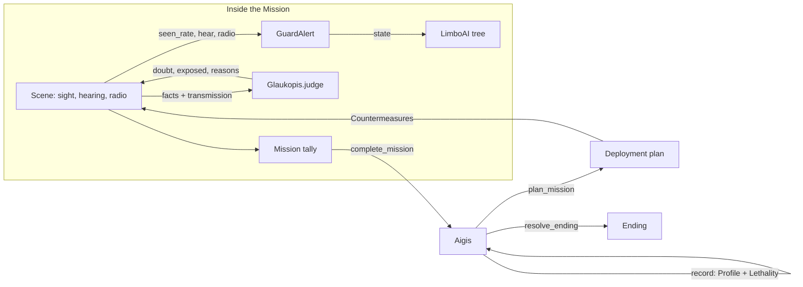
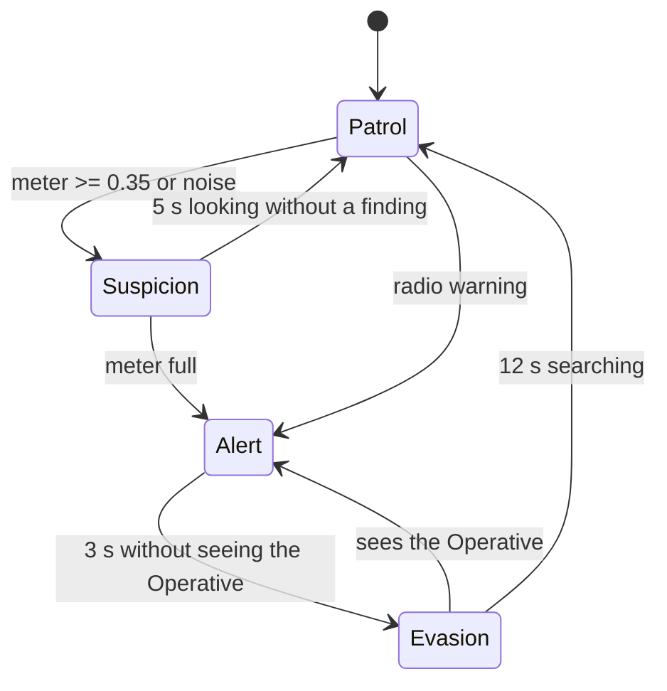
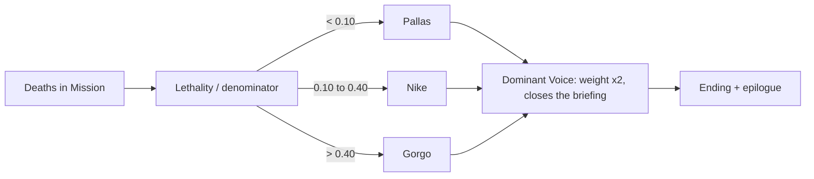

# Ghost Layer: Game AI for an Enemy That Learns

Written for the game AI evaluation. Spanish; the code identifier appears in parentheses the first time. Target length: 4 to 6 pages plus the appendix. Export to PDF from this file (see "Export" at the end).

> **Pending a person (not invented here):** everything marked `TODO(human)` needs a real play session, screenshots or measurements. The deployment tables and cited rules come from the code and from `docs/deployment-tables.md`, not from playthroughs.

## 1. The Game on One Page

Ghost Layer is a short stealth game. The player is the Operative (Operative), a member of Metis who infiltrates the Palladion facilities. The antagonist is Aigis, a tactical intelligence that **profiles** the Operative and adapts its forces **between missions**. The campaign has three Missions (Harbour, Relay Station, Research Annex) and the Core (Core), the room beneath the Harbour where Aigis lives.

Each Mission can be resolved in three ways (Approach): stealth, deception with spoofed transmissions (Spoofing), or noise. What the player repeats becomes their Profile (Profile) of six Habits (Habits), and Aigis responds with Countermeasures (Countermeasures). Design pillar: **adaptation must be seen and heard**; a countermeasure the player doesn't perceive gets cut.

## 2. AI Architecture (Central Section)

Three layers. Each pure module uses no nodes and is deterministic; the scenes gather facts, call the module, and only read its results (ADR-0001, `docs/adr/0001-aigis-plans-only-between-missions.md`).

| Layer | Module | When it acts |
|---|---|---|
| Guards | LimboAI behaviour tree (`actors/guard/guard_tree.tres`) over the pure alert state machine (`actors/guard/guard_alert.gd`) | inside the Mission, every frame |
| Glaukopis | spoofing judge (`ai/glaukopis.gd`) | inside the Mission, per transmission |
| Aigis | campaign module (`ai/aigis.gd`) | only between Missions |

Key decision: Aigis **does not** plan during the Mission (ADR-0001). Adding Voice behaviour inside the Mission would be a new seam (passing weights into the tree), not a tweak. This means the same Preset always yields the same deployment, which lets us generate the tables in section 8 through tests.

## 3. Guards

Each guard runs a LimboAI tree whose root selector (`Guard`) tries, in order: Alert, Evasion, Suspicion, Order and Patrol. Each branch is a sequence "state condition + action" (`bt_in_state.gd`, `bt_chase.gd`, `bt_search_spot.gd`, `bt_turn_to_spot.gd`, `bt_follow_order.gd`, `bt_patrol.gd`). The tree restarts when the state changes.

`TODO(human)`: screenshot of the `guard_tree.tres` tree open in the LimboAI editor (`docs/img/guard-tree.png`).

The alert machine (`GuardAlert`) exposes the interface `tick(delta, seen_rate, seen_pos, why, at_target)`, `hear(...)`, `radio(...)`, and each call returns a reason string that the F3 overlay displays.

Values from the code: suspicion at 0.35 (shows "?"), alert with the meter full ("!", the radio alerts everyone), drain 0.25/s, `LOOK_TIME` 5 s, `LOSE_TIME` 3 s, `SEARCH_TIME` 12 s. The fill rate is computed by the scene (front cone of 30° and 16 m, peripheral cone of 60° and 6 m at half rate; crouched x0.5, still x0.6, running x1.5, within 3 m x4). Hearing: running footsteps 6 m, impact 10 m, loud gunshot 40 m; noise produces suspicion, never alert.

## 4. Operative Profile

Six Habits (`HABITS`): stealth (stealth), combat (combat), headshots (headshots), takedowns (takedowns), downs (downs) and spoofing (spoofing). Each action adds points; level = points / 100, capped per Mission at 0 / 1 / 2 / 3 (`CAPS`). Stealth and Combat are a tug of war: the Mission sets a tendency, adding to one side and subtracting from the other; a Mission with no alert counts as stealth. The other four Habits decay by half a level per Mission if unused. An aborted Mission is never recorded (`complete_mission`).

## 5. Aigis: Utility-Based Planning (Central Section)

`plan_mission(profile, lethality, mission_index)` returns weights, dominant Voice, budget, pinned Habit, choices with candidates, and briefing keys.

1. **Weights:** the dominant Voice weighs 2.0 and the other four 1.0 (`DOMINANT_WEIGHT`, `OTHER_WEIGHT`).
2. **Budget** of response levels per Mission: 0 / 2 / 4 / 6 (`BUDGETS`).
3. **Pinned:** the strongest Habit (highest level; ties broken by points) gets its entire response unlocked first.
4. **Greedy fill:** candidates are the next unlocked rung of each Habit; score = sponsoring Voice's weight x Habit points; the highest is taken, and ties follow the order of the Habits table.

It is deterministic: same inputs, same plan. Lethality leaks in openly through the deployment (a lethal campaign receives more Gorgo equipment) while the number itself stays silent and separate from the Profile.

Example (section 8.2): under the Butcher Preset in the Core, the pinned Habit is Combat, the budget is 6, and the plan is vests, +2 guards, 2 reinforcements per alert, and helmets at 33 %, 66 % and 100 %.

## 6. Glaukopis: The Spoofing Judge

Glaukopis (`Glaukopis.judge(facts, commit)`) is the only Aigis logic active inside the Mission, and it does not depend on the Voice weights. It sums deterministic doubt points and exposes the transmission at 40 or more (25 or more with Spoofing level 1). Main facts: voiceprint already flagged +100; the speaker is the recipient +100; a recipient sees the speaker +60; some guard knows the speaker is down +60; "all clear" while a recipient sees the Operative +100; contradicts an order issued less than 30 s ago +30; each transmission in the last 60 s +15.

If exposed, the voiceprint is flagged permanently and recipients search within 5 m of the transmission's origin. The player only hears the guard's line ("you don't sound right"); the doubt and reasons go only to the F3 overlay. Spoofing level 2 adds a verification call to the speaker; level 3 makes voiceprints single-use.

## 7. Lethality, Dominant Voice and Ending

Each death silently adds to Lethality (guard 1, Target 3). The Lethality ratio is Lethality / denominator (guards actually generated + 3 per Target) and picks a band with `resolve_ending`: below 0.10 Pallas, 0.10 to 0.40 Nike, above 0.40 Gorgo (a value exactly on the threshold goes to the higher band; undefined before Mission 1, Pallas band). The band sets the dominant Voice, which closes every briefing, weighs double in the plan, and decides the ending after the final transmission in the Core and the final debate. The Glaukopis lines in the debate reflect the Spoofing level.

## 8. Evidence (Central Section)

### 8.1 How It Is Generated

`tests/test_aigis.gd` runs `plan_mission` for each Preset in each Mission and writes `docs/deployment-tables.md`. What is cited below is a copy of that output; if the balance is tuned again, it must be regenerated and re-cited.

### 8.2 Deployment Tables (Preset x Mission)

Each step is read as `what [sponsoring Voice, score]` in deployment order; pinned-Habit steps come first. Mission 1 never deploys anything (budget 0).

**Clean slate** (all Habits at 0, ratio undefined; dominant Voice Pallas)

| Mission | Budget | Pinned | Deployed |
|---|---|---|---|
| 1 (Harbour) | 0 | none | none |
| 2 (Relay Station) | 2 | none | none |
| 3 (Research Annex) | 4 | none | none |
| Core | 6 | none | none |

**Butcher** (Combat 3, Headshots 3, Takedowns 1; ratio 0.60; dominant Voice Gorgo)

| Mission | Budget | Pinned | Deployed |
|---|---|---|---|
| 1 (Harbour) | 0 | none | none |
| 2 (Relay Station) | 2 | Combat | vests [Gorgo, pinned]; helmets 33 % [Gorgo, 600] |
| 3 (Research Annex) | 4 | Combat | vests [Gorgo, pinned]; +2 guards [Promachos, pinned]; helmets 33 % [Gorgo, 600]; helmets 66 % [Gorgo, 600] |
| Core | 6 | Combat | vests [Gorgo, pinned]; +2 guards [Promachos, pinned]; 2 reinforcements per alert [Promachos, pinned]; helmets 33 % [Gorgo, 600]; helmets 66 % [Gorgo, 600]; helmets 100 % [Gorgo, 600] |

**Ghost** and **Trickster**, Core only (full tables in `docs/deployment-tables.md`):

| Preset | Habits / ratio | Pinned | Deployed in the Core |
|---|---|---|---|
| Ghost | Stealth 3, Takedowns 2, Downs 2; 0.00 (Pallas) | Stealth | cameras [Glaukopis, pinned]; one extra patrol [Promachos, pinned]; watch sentries [Gorgo, pinned]; guards who turn around more [Pallas, 400]; random base sweep [Pallas, 400]; paired patrols [Gorgo, 200] |
| Trickster | Spoofing 3, Stealth 1, Headshots 2; 0.25 (Nike) | Spoofing | Glaukopis threshold 40 to 25 [pinned]; callback [pinned]; single-use voiceprints [pinned]; helmets 33 % [Gorgo, 200]; helmets 66 % [Gorgo, 200]; cameras [Glaukopis, 100] |

Reading: the same four Habits produce different responses depending on the dominant Voice, and the pinned Habit always deploys first. `TODO(human)`: check that the cited rows still match `docs/deployment-tables.md` after the final balance pass.

### 8.3 Before and After

`TODO(human)`: screenshots of the Harbour (Mission 1) under Clean slate and of the Core under Butcher, same camera. Insert `docs/img/before-clean-slate.png` and `docs/img/after-butcher-core.png`. Note: the Harbour itself does not change between Presets (budget 0), so the honest comparison is Harbour under Clean slate versus the Core (which sits below the Harbour) under Butcher.

### 8.4 Debug Overlay (F3) Screenshots

`TODO(human)`: three overlay screenshots: (a) Profile, weights and plan with the candidate scores in the briefing; (b) Glaukopis doubt and reasons after an exposed transmission; (c) the reason a guard detected the Operative. Planned files in `docs/img/`.

### 8.5 Play Measurements

`TODO(human)`: this document contains no measurements from real play. If we want to cite them (time per Mission, number of alerts, Glaukopis exposure rate), they must be recorded by playing; they are not estimated here.

## 9. Limits and Future Work

- Aigis only plans between Missions; there is no adaptation within a Mission (ADR-0001 decision; a new seam would be needed to change it).
- Deterministic and without machine learning: this is game AI (utility, behaviour trees, state machines), not ML. It is a profile of six counters, not a model of the player.
- Firing values and band thresholds were tuned through simulation tests, not player tests. `TODO(human)`: a play session to validate.
- A single campaign run covers one Preset; the campaign does not exhaustively mix styles.
- Future: Voice weights inside the guard tree, a cheaper targeted sweep, more Areas.

## 10. References

- Project: `docs/adr/0001-aigis-plans-only-between-missions.md`, `docs/GLOSSARY.md`, `docs/deployment-tables.md`, the revenge-system and profile design notes (kept in the author's local, git-ignored `.scratch/` folder, not part of the repo).
- LimboAI, behaviour trees and state machines for Godot (MIT license): https://github.com/limbonaut/limboai
- Godot Engine 4.x: https://godotengine.org
- `TODO(human)`: add the academic or course references the class requires.

---

## Appendix A. Demo Script (~10 min, repeatable in Free mode)

Free mode never touches the Profile, the Lethality or saved games, so it can be repeated on any machine. Turn on F3 before starting. Times are a guide, not a measurement.

1. **Harbour under Clean slate (~2 min).** Menu, Free mode, Clean slate preset, Mission 1. Walk through the Harbour. Show that there are no cameras, extra patrols or helmets. In F3: budget 0, no choices.
2. **Core under Butcher (~2 min).** Back to Free mode, Butcher preset, Core. Briefing with F3: dominant Voice Gorgo, pinned Habit Combat and the score table. Start the Mission and show vests and helmets; shoot a guard (the vest stops the tranquilizer) and trigger an alert to see the 2 reinforcements.
3. **Ghost (~2 min).** Ghost preset, Core. Briefing: dominant Voice Pallas, cameras, extra patrol, sentries. Show a camera and how guards turn around more. Contrast with step 2: same Core, different deployment.
4. **Live spoofing with Glaukopis doubting (~3 min).** Trickster preset (or Custom with Spoofing 3), Mission 2 or 3. Capture a voiceprint, open the radial menu and send a credible order (go check a spot). Then an unconvincing one (for example "all clear" with a recipient watching you). In F3 read the doubt and its reasons; the guard says the "you don't sound right" line and searches near where you transmitted.
5. **Ending screen (~1 min).** From Free mode, reach the final transmission and the final debate in the Core. Show how the Lethality band (F3: raw, ratio, band, projected ending) matches the ending that appears. Repeat with Custom by moving the ratio control to see the three endings.

To reproduce the evidence: run the tests (`tools/run_tests.tscn`) and compare `docs/deployment-tables.md` with section 8.2.

`TODO(human)`: rehearse the full script with a stopwatch and adjust the timings; confirm the exact in-game menu names.

## Export to PDF

There is no `pandoc` or `mmdc` in the build environment, so the PDF was not generated here. Once screenshots exist: render the three Mermaid diagrams to images (or export from a viewer that renders them, such as VS Code with "Markdown PDF") and export `docs/writeup.md` to `docs/writeup.pdf`. Check that the PDF is 4 to 6 pages before the appendix.
