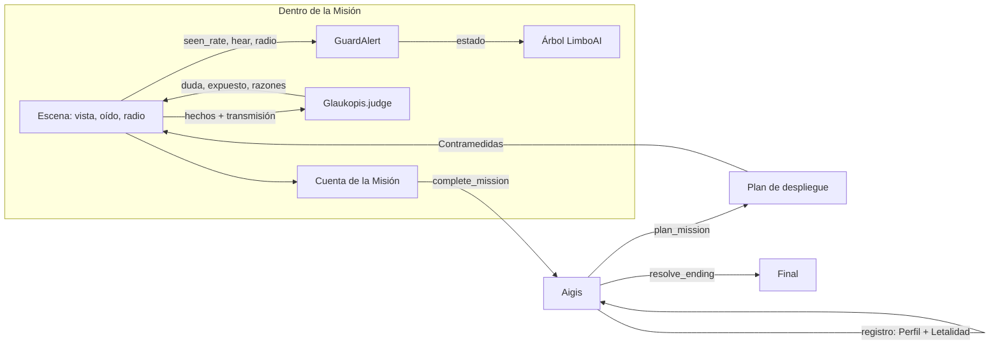
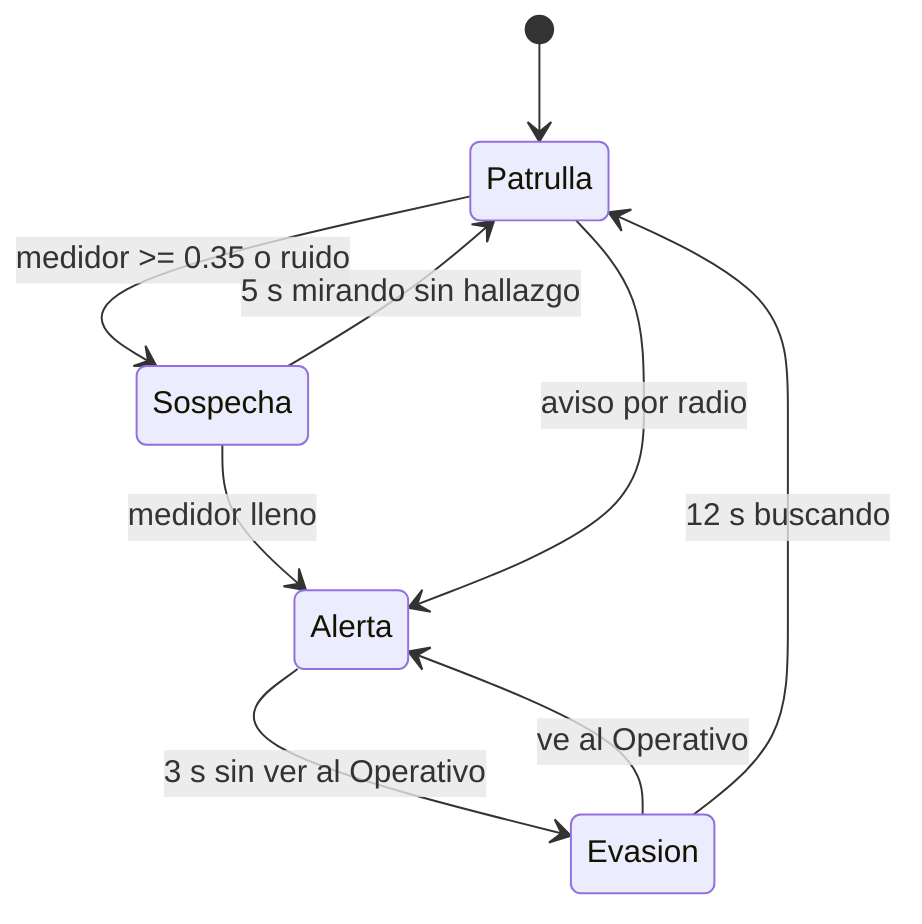
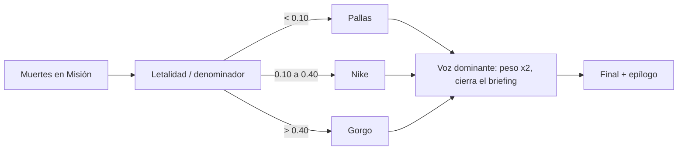

# Ghost Layer: IA de juego para un enemigo que aprende

Escrito para la evaluación de IA de juego. Español; el identificador de código va entre paréntesis la primera vez. Longitud objetivo: 4 a 6 páginas más el apéndice. Exportar a PDF desde este archivo (ver "Exportación" al final).

> **Pendiente de una persona (no inventado aquí):** todo lo marcado `TODO(humano)` necesita una sesión de juego real, capturas o medidas. Las tablas de despliegue y las reglas citadas salen del código y de `docs/deployment-tables.md`, no de partidas.

## 1. El juego en una página

Ghost Layer es un juego de sigilo corto. El jugador es el Operativo (Operative), un miembro de Metis que se infiltra en las instalaciones de Palladion. El antagonista es Aigis, una inteligencia táctica que **perfila** al Operativo y adapta sus fuerzas **entre misiones**. La campaña tiene tres Misiones (Puerto, Estación de relevo, Anexo de investigación) y el Núcleo (Core), la sala bajo el Puerto donde vive Aigis.

Cada Misión se puede resolver de tres maneras (Approach): sigilo, engaño con transmisiones suplantadas (Spoofing) o ruido. Lo que el jugador repite se convierte en su Perfil (Profile) de seis Hábitos (Habits), y Aigis responde con Contramedidas (Countermeasures). Pilar de diseño: **la adaptación debe verse y oírse**; una contramedida que no se percibe se recorta.

## 2. Arquitectura de la IA (sección central)

Tres capas. Cada módulo puro no usa nodos y es determinista; las escenas reúnen hechos, llaman al módulo y solo leen sus resultados (ADR-0001, `docs/adr/0001-aigis-plans-only-between-missions.md`).

| Capa | Módulo | Cuándo actúa |
|---|---|---|
| Guardias | árbol de comportamiento LimboAI (`actors/guard/guard_tree.tres`) sobre la máquina de alerta pura (`actors/guard/guard_alert.gd`) | dentro de la Misión, cada fotograma |
| Glaukopis | juez de suplantación (`ai/glaukopis.gd`) | dentro de la Misión, por cada transmisión |
| Aigis | módulo de campaña (`ai/aigis.gd`) | solo entre Misiones |

Decisión clave: Aigis **no** planifica durante la Misión (ADR-0001). Añadir comportamiento de las Voces dentro de la Misión sería una costura nueva (pasar pesos al árbol), no un ajuste. Esto hace que el mismo Preset dé siempre el mismo despliegue, lo que permite generar las tablas de la sección 8 con pruebas.

## 3. Guardias

Cada guardia ejecuta un árbol LimboAI cuyo selector raíz (`Guard`) prueba, en orden: Alerta, Evasión, Sospecha, Orden y Patrulla. Cada rama es una secuencia "condición de estado + acción" (`bt_in_state.gd`, `bt_chase.gd`, `bt_search_spot.gd`, `bt_turn_to_spot.gd`, `bt_follow_order.gd`, `bt_patrol.gd`). El árbol se reinicia cuando cambia el estado.

`TODO(humano)`: captura del árbol `guard_tree.tres` abierto en el editor de LimboAI (`docs/img/guard-tree.png`).

La máquina de alerta (`GuardAlert`) tiene la interfaz `tick(delta, seen_rate, seen_pos, why, at_target)`, `hear(...)`, `radio(...)`, y cada llamada devuelve una cadena de razón que el overlay F3 muestra.

Valores del código: sospecha en 0.35 (muestra "?"), alerta con el medidor lleno ("!", la radio avisa a todos), drenaje 0.25/s, `LOOK_TIME` 5 s, `LOSE_TIME` 3 s, `SEARCH_TIME` 12 s. El ritmo de llenado lo calcula la escena (cono frontal de 30° y 16 m, cono periférico de 60° y 6 m a media tasa; agachado x0.5, quieto x0.6, correr x1.5, a menos de 3 m x4). Oído: pasos corriendo 6 m, golpe 10 m, disparo ruidoso 40 m; el ruido da sospecha, nunca alerta.

## 4. Perfil del Operativo

Seis Hábitos (`HABITS`): sigilo (stealth), combate (combat), tiros a la cabeza (headshots), derribos (takedowns), caídos (downs) y suplantación (spoofing). Cada acción suma puntos; nivel = puntos / 100, con tope por Misión 0 / 1 / 2 / 3 (`CAPS`). Sigilo y Combate son un tira y afloja: la Misión decide una tendencia y suma a un lado y resta al otro; una Misión sin alerta cuenta como sigilo. Los otros cuatro Hábitos decaen medio nivel por Misión si no se usan. Una Misión abortada nunca se incorpora al registro (`complete_mission`).

## 5. Aigis: planificación por utilidad (sección central)

`plan_mission(profile, lethality, mission_index)` devuelve pesos, Voz dominante, presupuesto, Hábito fijado (pinned), elecciones con candidatos y claves del briefing.

1. **Pesos:** la Voz dominante pesa 2.0 y las otras cuatro 1.0 (`DOMINANT_WEIGHT`, `OTHER_WEIGHT`).
2. **Presupuesto** de niveles de respuesta por Misión: 0 / 2 / 4 / 6 (`BUDGETS`).
3. **Fijado:** el Hábito más fuerte (más nivel; desempate por puntos) obtiene primero toda su respuesta desbloqueada.
4. **Relleno voraz:** los candidatos son el siguiente escalón desbloqueado de cada Hábito; puntuación = peso de la Voz patrocinadora x puntos del Hábito; se toma la más alta y el desempate sigue el orden de la tabla de Hábitos.

Es determinista: mismas entradas, mismo plan. La Letalidad se filtra de forma aceptada en el despliegue (una campaña letal recibe más equipo de Gorgo) mientras el número queda en silencio y separado del Perfil.

Ejemplo (sección 8.2): bajo el Preset Butcher en el Núcleo el Hábito fijado es Combate, el presupuesto es 6 y el plan es chalecos, +2 guardias, 2 refuerzos por alerta y cascos al 33 %, 66 % y 100 %.

## 6. Glaukopis: el juez de suplantación

Glaukopis (`Glaukopis.judge(facts, commit)`) es la única lógica de Aigis dentro de la Misión y no depende de los pesos de las Voces. Suma puntos de duda deterministas y expone la transmisión con 40 o más (25 o más con Suplantación nivel 1). Hechos principales: huella de voz (Voiceprint) ya marcada +100; el hablante es el destinatario +100; un destinatario ve al hablante +60; algún guardia sabe que el hablante está caído +60; "todo despejado" mientras un destinatario ve al Operativo +100; contradice una orden de hace menos de 30 s +30; cada transmisión de los últimos 60 s +15.

Si se expone, la huella queda marcada para siempre y los destinatarios buscan a menos de 5 m del origen de la transmisión. El jugador solo oye la línea del guardia ("no suenas bien"); la duda y las razones van únicamente al overlay F3. Suplantación nivel 2 añade una llamada de verificación al hablante; nivel 3 hace las huellas de un solo uso.

## 7. Letalidad, Voz dominante y final

Cada muerte suma en silencio a la Letalidad (guardia 1, Objetivo 3). La razón de Letalidad es Letalidad / denominador (guardias realmente generados + 3 por Objetivo) y elige banda con `resolve_ending`: menos de 0.10 Pallas, de 0.10 a 0.40 Nike, más de 0.40 Gorgo (un valor justo en el umbral va a la banda alta; indefinida antes de la Misión 1, banda Pallas). La banda define la Voz dominante, que cierra cada briefing, pesa doble en el plan y decide el final tras la transmisión final en el Núcleo y el debate final. Las líneas de Glaukopis en el debate reflejan el nivel de Suplantación.

## 8. Evidencia (sección central)

### 8.1 Cómo se genera

`tests/test_aigis.gd` ejecuta `plan_mission` para cada Preset en cada Misión y escribe `docs/deployment-tables.md`. Lo citado abajo es una copia de esa salida; si se vuelve a ajustar el balance hay que regenerar y volver a citar.

### 8.2 Tablas de despliegue (Preset x Misión)

Cada paso se lee `qué [Voz patrocinadora, puntuación]` en orden de despliegue; los pasos del Hábito fijado van primero. La Misión 1 nunca despliega nada (presupuesto 0).

**Clean slate** (todos los Hábitos a 0, razón indefinida; Voz dominante Pallas)

| Misión | Presupuesto | Fijado | Desplegado |
|---|---|---|---|
| 1 (Puerto) | 0 | ninguno | ninguno |
| 2 (Estación de relevo) | 2 | ninguno | ninguno |
| 3 (Anexo de investigación) | 4 | ninguno | ninguno |
| Núcleo | 6 | ninguno | ninguno |

**Butcher** (Combate 3, Tiros a la cabeza 3, Derribos 1; razón 0.60; Voz dominante Gorgo)

| Misión | Presupuesto | Fijado | Desplegado |
|---|---|---|---|
| 1 (Puerto) | 0 | ninguno | ninguno |
| 2 (Estación de relevo) | 2 | Combat | chalecos [Gorgo, fijado]; cascos 33 % [Gorgo, 600] |
| 3 (Anexo de investigación) | 4 | Combat | chalecos [Gorgo, fijado]; +2 guardias [Promachos, fijado]; cascos 33 % [Gorgo, 600]; cascos 66 % [Gorgo, 600] |
| Núcleo | 6 | Combat | chalecos [Gorgo, fijado]; +2 guardias [Promachos, fijado]; 2 refuerzos por alerta [Promachos, fijado]; cascos 33 % [Gorgo, 600]; cascos 66 % [Gorgo, 600]; cascos 100 % [Gorgo, 600] |

**Ghost** y **Trickster**, solo el Núcleo (tablas completas en `docs/deployment-tables.md`):

| Preset | Hábitos / razón | Fijado | Desplegado en el Núcleo |
|---|---|---|---|
| Ghost | Stealth 3, Takedowns 2, Downs 2; 0.00 (Pallas) | Stealth | cámaras [Glaukopis, fijado]; una patrulla extra [Promachos, fijado]; centinelas de vigilancia [Gorgo, fijado]; guardias que se giran más [Pallas, 400]; sondeo aleatorio de la base [Pallas, 400]; patrullas en pareja [Gorgo, 200] |
| Trickster | Spoofing 3, Stealth 1, Headshots 2; 0.25 (Nike) | Spoofing | umbral de Glaukopis 40 a 25 [fijado]; devolución de llamada [fijado]; huellas de un solo uso [fijado]; cascos 33 % [Gorgo, 200]; cascos 66 % [Gorgo, 200]; cámaras [Glaukopis, 100] |

Lectura: los mismos cuatro Hábitos producen respuestas distintas según la Voz dominante, y el Hábito fijado siempre se despliega primero. `TODO(humano)`: comprobar que las filas citadas siguen coincidiendo con `docs/deployment-tables.md` tras el ajuste de balance final.

### 8.3 Antes y después

`TODO(humano)`: capturas del Puerto (Misión 1) bajo Clean slate y del Núcleo bajo Butcher, misma cámara. Insertar `docs/img/before-clean-slate.png` y `docs/img/after-butcher-core.png`. Nota: el Puerto en sí no cambia entre Presets (presupuesto 0), por eso la comparación honesta es Puerto bajo Clean slate frente al Núcleo (que está bajo el Puerto) bajo Butcher.

### 8.4 Capturas del overlay de depuración (F3)

`TODO(humano)`: tres capturas del overlay: (a) Perfil, pesos y plan con puntuaciones de cada candidato en el briefing; (b) duda y razones de Glaukopis tras una transmisión expuesta; (c) razón por la que un guardia detectó al Operativo. Archivos previstos en `docs/img/`.

### 8.5 Medidas de juego

`TODO(humano)`: no hay medidas de partidas reales en este documento. Si se quieren citar (tiempo por Misión, número de alertas, tasa de exposición de Glaukopis), hay que registrarlas jugando; no se estiman aquí.

## 9. Límites y trabajo futuro

- Aigis solo planifica entre Misiones; no hay adaptación dentro de una Misión (decisión de ADR-0001, costura nueva para cambiarlo).
- Determinista y sin aprendizaje automático: es IA de juego (utilidad, árboles de comportamiento, máquinas de estado), no ML. Es un perfil de seis contadores, no un modelo del jugador.
- Los valores de disparo y los umbrales de bandas se ajustaron por pruebas de simulación, no por pruebas con jugadores. `TODO(humano)`: sesión de juego para validar.
- Una sola partida de campaña cubre un Preset; la campaña no mezcla estilos de forma exhaustiva.
- Futuro: pesos de las Voces dentro del árbol del guardia, sondeo dirigido más barato, más Áreas.

## 10. Referencias

- Proyecto: `docs/adr/0001-aigis-plans-only-between-missions.md`, `GLOSSARY.md`, `docs/deployment-tables.md`, `.scratch/ghost-layer/research/revenge-system.md` (sistema de venganza y perfiles, referencia de diseño).
- LimboAI, árboles de comportamiento y máquinas de estado para Godot (licencia MIT): https://github.com/limbonaut/limboai
- Godot Engine 4.x: https://godotengine.org
- `TODO(humano)`: añadir las referencias académicas o de la asignatura que el curso exija.

---

## Apéndice A. Guion de demostración (~10 min, repetible en Free mode)

Free mode nunca toca el Perfil, la Letalidad ni las partidas guardadas, así que se puede repetir en cualquier máquina. Activar F3 antes de empezar. Los tiempos son una guía, no una medición.

1. **Puerto bajo Clean slate (~2 min).** Menú, Free mode, Preset Clean slate, Misión 1. Recorrer el Puerto. Mostrar que no hay cámaras, patrullas extra ni cascos. En F3: presupuesto 0, sin elecciones.
2. **Núcleo bajo Butcher (~2 min).** Volver a Free mode, Preset Butcher, Núcleo. Briefing con F3: Voz dominante Gorgo, Hábito fijado Combate y la tabla de puntuaciones. Empezar la Misión y mostrar chalecos y cascos; disparar a un guardia (el chaleco detiene el tranquilizante) y provocar una alerta para ver los 2 refuerzos.
3. **Ghost (~2 min).** Preset Ghost, Núcleo. Briefing: Voz dominante Pallas, cámaras, patrulla extra, centinelas. Mostrar una cámara y cómo los guardias se giran más. Contrastar con el paso 2: mismo Núcleo, otro despliegue.
4. **Suplantación en vivo con Glaukopis dudando (~3 min).** Preset Trickster (o Custom con Suplantación 3), Misión 2 o 3. Capturar una huella de voz, abrir el menú radial y enviar una orden creíble (ir a revisar un lugar). Luego una poco creíble (por ejemplo "todo despejado" con un destinatario viéndote). En F3 leer la duda y sus razones; el guardia dice la línea de "no suenas bien" y busca cerca de donde transmitiste.
5. **Pantalla de final (~1 min).** Desde Free mode llegar a la transmisión final y al debate final del Núcleo. Mostrar cómo la banda de Letalidad (F3: crudo, razón, banda, final proyectado) coincide con el final que aparece. Repetir con Custom moviendo el control de la razón para ver los tres finales.

Para reproducir la evidencia: correr las pruebas (`tools/run_tests.tscn`) y comparar `docs/deployment-tables.md` con la sección 8.2.

`TODO(humano)`: ensayar el guion completo con cronómetro y ajustar los tiempos; confirmar los nombres exactos de los menús del juego en español.

## Exportación a PDF

No hay `pandoc` ni `mmdc` en el entorno de construcción, así que el PDF no se generó aquí. Cuando haya capturas: renderizar los tres diagramas Mermaid a imagen (o exportar desde un visor que los renderice, como VS Code con "Markdown PDF") y exportar `docs/writeup.md` a `docs/writeup.pdf`. Comprobar que el PDF tiene entre 4 y 6 páginas antes del apéndice.
